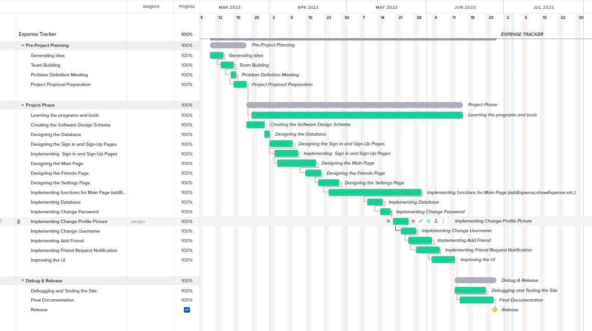

# Expense Tracker: A Social Way to Understand Your Spending

Most people lose track of where their money goes. Expense trackers exist to fix that, but they all treat spending as a private matter. This project asks a different question: **what if you could compare your habits with those of friends?** It is a web application that records expenses, shows where the money goes, and adds a social layer so that people can see and learn from one another's spending.

It was built as a four-person team project: a frontend team designed and implemented the interface, and a backend team built the server, authentication and database. This repository contains the **Spring Boot backend**.

## What the app does

- **Register and log in** with a unique username (authentication is handled by the backend).
- **Add an expense** from the main screen. Every new expense immediately updates the user's **budget, charts and expense history**, including a total per category and a free-text description for details.
- **Add friends** and browse their profiles and expense histories, so that a small "expense ecosystem" forms around each user.
- **Personalise** the budget and other settings.

## Why a social tracker?

A review of existing expense trackers (desktop and Android apps built with Java and MySQL, or Angular and SQLite) showed that they all share the same design: modules to add, delete, view and categorise expenses, often offline, with limits and reminders. Their authors list the same future work: reminders, backups, more record-keeping options. **None of them addresses the social side** of spending, even though many other applications have become social. Comparing with friends gives context ("is my food budget high?") that a private chart cannot.

## How the project was run

The team followed an **agile** cycle: plan, develop, test, review, repeat.

1. **Planning.** Idea generation, scope and a project proposal, with the schedule kept on a Gantt chart so that everyone could see what was ongoing, finished and still to come.
2. **Design and development.** An entity-relationship diagram defined the database; the interface was prototyped first (in Figma), then implemented, with the backend, the API and the frontend built in parallel and merged regularly.
3. **Debugging and testing.** The system was tested as a team after every step.

## What the project achieved

- A working web application with registration, login, expense logging, category totals, charts, budget management and a friends feature.
- A **responsive** frontend that fit all tested screen sizes, and an API that also worked when accessed from another device on the network (for example a phone emulator).
- Bugs were found early because every step ended with a joint test, and merging individual work went smoothly.

## What we learned and what comes next

- Splitting work into frontend and backend only works if the API between them is agreed early and tested continuously.
- A prototype in a design tool saves a lot of rework: the interface was settled before any code was written.
- Planned improvements: automatic daily expense notifications, more record-keeping options, user-defined categories, and richer social features such as sharing financial goals and progress with friends.

## Files

- `backend-spring-boot/`: the REST backend: JWT-based authentication, and controllers for users, expenses and friendships, backed by a relational database
